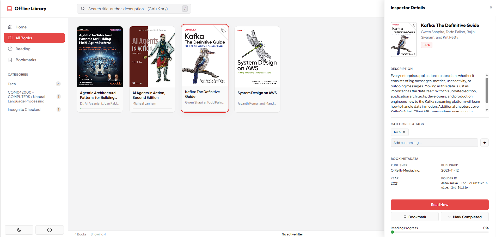
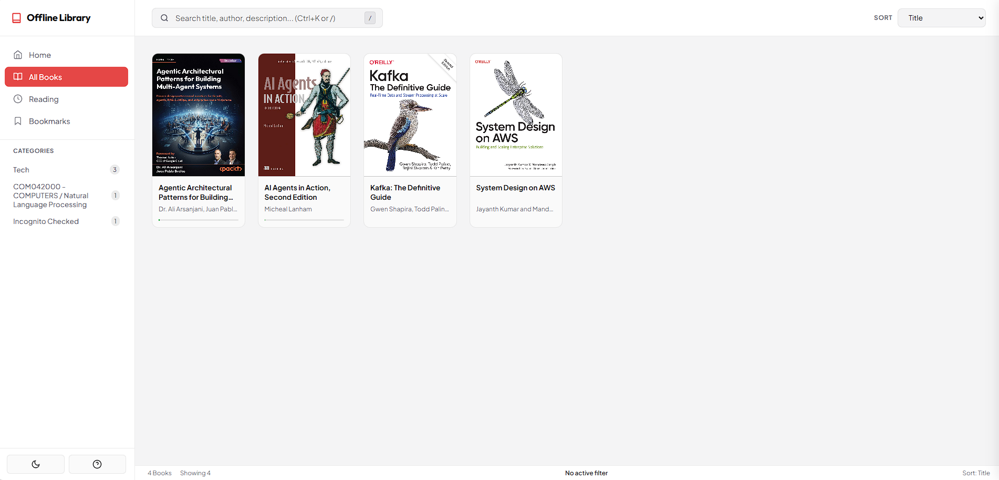
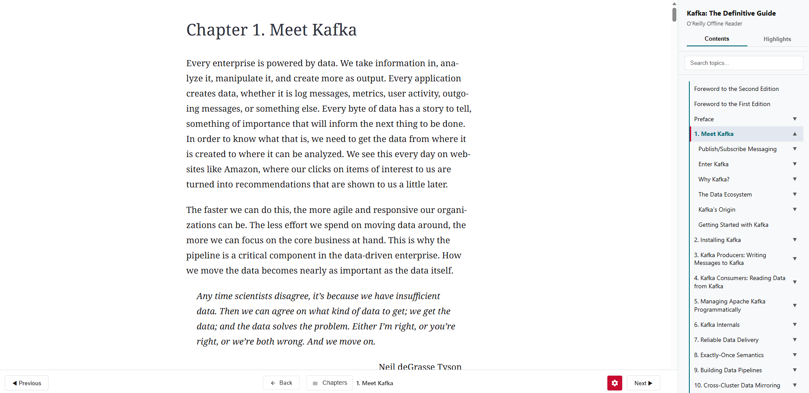

[](https://github.com/vicky-dx/oreilly-course-downloader/blob/main/LICENSE)
[](https://www.python.org/downloads/)
[](https://github.com/astral-sh/uv)
[](https://github.com/vicky-dx/oreilly-course-downloader/stargazers)
[](https://github.com/vicky-dx/oreilly-course-downloader/network/members)
[](https://github.com/vicky-dx/oreilly-course-downloader/graphs/contributors)

# O'Reilly Offline Downloader & Library

A powerful, high-performance Python CLI for downloading **O'Reilly Learning** courses, books, and audiobooks for offline personal study. It supports video courses, EPUB generation, audiobook downloads, interactive web readers, transcripts, and a premium offline library dashboard.

> **Architecture:** The project is built as a modern Python package managed with **uv**, providing fast dependency management, clean installation, and cross-platform support.

------------------------------------------------------------------------

# ✨ Features

## Downloading

- Download complete O'Reilly video courses (at selectable resolutions)
- Download audiobooks as high-quality `.m4a`
- Download books as standard `.epub`
- Generate interactive offline HTML web readers
- Extract timestamped video transcripts
- Transcripts-only mode for fast text extraction

## Offline Library

- Premium Apple Books-inspired dashboard
- Automatic library indexing
- Fast search & metadata inspector
- Reading progress & persistent custom tags
- Keyboard navigation (arrows, space, enter, search shortcuts)
- Dark & Light themes
- Automatic cover image detection

## Downloader Engine

- **Stealth Automation:** Undetected-chromedriver bypasses cloud bot detections
- **Browser Flexibility:** Supports Chrome, Brave, Chromium, Edge, or Firefox
- **Customizable Locations:** Specify custom output directories and browser binaries via CLI or environment variables
- **Parallel downloads** with bounded thread workers
- **Resilient Retry Policy** with Dead Letter Queue (DLQ) logging
- **Authentication flexibility:** Manual login, credential login, or automated Gmail trial signup

------------------------------------------------------------------------

# 🚀 Quick Start

## Requirements

1. **Python 3.12+**
2. **uv** (Package manager)
3. **ffmpeg** (Required for video/audio assembly)
4. **Google Chrome / Chromium** (Required for default `stealth` and `chrome` browser engines) or **Firefox** (for `--browser firefox`)

### 1. Install uv

```bash
# Windows
powershell -ExecutionPolicy ByPass -c "irm https://astral.sh/uv/install.ps1 | iex"

# Linux/macOS
curl -LsSf https://astral.sh/uv/install.sh | sh
```

### 2. Install ffmpeg

```bash
# Windows (via Chocolatey or Scoop)
choco install ffmpeg
# or: scoop install ffmpeg

# macOS
brew install ffmpeg

# Ubuntu/Debian
sudo apt update && sudo apt install -y ffmpeg

# Fedora
sudo dnf install ffmpeg

# Arch Linux
sudo pacman -S ffmpeg
```

### 3. Install Google Chrome / Chromium

The default automation engine (`--browser stealth`) uses `undetected-chromedriver`, which requires Google Chrome or a Chromium-based browser:

```bash
# Ubuntu / Debian
wget https://dl.google.com/linux/direct/google-chrome-stable_current_amd64.deb
sudo apt install ./google-chrome-stable_current_amd64.deb
# or install Chromium:
sudo apt install -y chromium-browser

# macOS
brew install --cask google-chrome

# Windows
# Download from https://www.google.com/chrome/ or:
winget install Google.Chrome
```

> **Using Brave, Edge, or a custom browser location?** Pass the `-b / --browser-binary` option or set the `OREILLY_BROWSER_BINARY` environment variable (see [Custom Browser Binary](#custom-browser-binary)).

------------------------------------------------------------------------

# Usage

## Download a Course

```bash
uv run oreilly-dl "COURSE_URL"
```

## Download with Custom Output Directory

You can specify where downloads and the library dashboard are saved using `-o` or `--output-dir`:

```bash
uv run oreilly-dl "COURSE_URL" -o "D:/Learning/OReilly"
```

You can also set the default output directory globally via environment variable:

```bash
# Linux/macOS
export OREILLY_OUTPUT_DIR="/path/to/my/library"

# Windows (PowerShell)
$env:OREILLY_OUTPUT_DIR = "D:\Learning\OReilly"
```

## Custom Browser Binary

If Google Chrome is installed in a non-standard path, or if you prefer using Brave, Edge, or Chromium:

```bash
# Windows (e.g. Brave or custom Chrome location)
uv run oreilly-dl "COURSE_URL" -b "C:\Program Files\BraveSoftware\Brave-Browser\Application\brave.exe"

# Linux (Chromium)
uv run oreilly-dl "COURSE_URL" -b "/usr/bin/chromium-browser"

# Set persistently via environment variable:
export OREILLY_BROWSER_BINARY="/usr/bin/google-chrome"
```

## Download an EPUB Book

```bash
uv run oreilly-dl "BOOK_URL" --epub
```

## Download with Interactive Web Reader & Offline Library

```bash
uv run oreilly-dl "BOOK_URL" --web-viewer
```

Books downloaded using `--web-viewer` are automatically indexed inside the Offline Library Dashboard.

## Download an Audiobook

```bash
uv run oreilly-dl "AUDIOBOOK_URL" --audiobook
```

## Transcripts Only

```bash
uv run oreilly-dl "COURSE_URL" --transcripts-only
```

## Authentication Options

### Manual Login (Recommended for First Run)
Opens a visible browser window allowing you to log in with SSO, corporate credentials, or 2FA. The session is saved to a persistent profile for future headless runs:

`ash
uv run oreilly-dl --manual-login --browser stealth
```

### Direct Credentials
```bash
uv run oreilly-dl "COURSE_URL" --email "your@email.com" --password "yourpassword"
```

### Auto-Signup (Gmail Dot Trick)
Automatically registers a new trial account:

```bash
uv run oreilly-dl "COURSE_URL" --auto-signup --base-email "username@gmail.com"
```

------------------------------------------------------------------------

# 🏛️ Offline Library Dashboard

The Offline Library Dashboard provides a centralized interface for browsing, organizing, and reading downloaded books.

### 📸 Screenshot Gallery

**Unified Library Dashboard**



**Metadata Inspector Drawer**



**Interactive Local eBook Reader**



## Keyboard Shortcuts

| Key | Action |
|:---|:---|
| <kbd>↑</kbd> / <kbd>↓</kbd> | Navigate books |
| <kbd>Space</kbd> | Toggle details drawer |
| <kbd>Enter</kbd> | Open reader |
| <kbd>/</kbd> or <kbd>Ctrl+K</kbd> | Focus search bar |
| <kbd>?</kbd> | Show keyboard shortcuts modal |

## 🚀 Launching the Offline Library

After downloading one or more books with `--web-viewer`, the Offline Library Dashboard is ready under `<output-dir>/books/`:

```text
downloads/
└── books/
    ├── data/                    # Book assets & reader files
    ├── index.html               # Offline Library Dashboard
    ├── library_state.json       # Library metadata & custom tags
    ├── serve_library.py         # Local HTTP server
    ├── start_library.bat        # Windows launcher
    └── start_library.sh         # Linux/macOS launcher
```

To start the local library server:

- **Windows:** Double-click `start_library.bat`
- **Linux/macOS:** Run `./start_library.sh`

The launcher starts a local server and automatically opens the library in your default browser.

------------------------------------------------------------------------

# 📁 Output Directory Structure

```text
<output-dir>/                    # Defaults to 'downloads/' or $OREILLY_OUTPUT_DIR
├── books/
│   ├── data/                    # Downloaded EPUBs & Web Reader assets
│   ├── index.html               # Offline Library Dashboard
│   ├── library_state.json       # Library metadata & tags
│   ├── serve_library.py         # Local HTTP server
│   ├── start_library.bat        # Windows launcher
│   └── start_library.sh         # Linux/macOS launcher
├── courses/                     # Video & audio course downloads
│   └── <Course Name>/
│       ├── course_structure.json
│       ├── failed_downloads.json (DLQ, if any errors occurred)
│       └── <Module>/
│           └── <Lesson>.mp4 / .txt
└── audiobooks/                  # Audiobook downloads (.m4a)
```

------------------------------------------------------------------------

# ⚙️ CLI Options Reference

```text
usage: oreilly-dl [url] [options]
```

| Flag | Short | Default | Description |
|:---|:---:|:---:|:---|
| `url` | | `None` | URL of the course, audiobook, or book to download. |
| `--output-dir` | `-o` | `downloads` | Root directory where downloads are saved. Supports `$OREILLY_OUTPUT_DIR`. |
| `--browser-binary` | `-b` | `None` | Custom path to browser executable (Chrome/Chromium/Firefox). Supports `$OREILLY_BROWSER_BINARY`. |
| `--browser` | | `stealth` | Browser automation engine: `stealth`, `chrome`, or `firefox`. |
| `--resolution` | `-r` | `best` | Target stream resolution: `best`, `1080p`, `720p`, `480p`, `360p`. |
| `--workers` | | `3` | Maximum concurrent segment and asset downloads. |
| `--no-headless` | | `False` | Run browser in non-headless (visible) window for debugging. |
| `--debug` | | `False` | Enable verbose disk logging to `downloader.log`. |
| `--epub` | | `False` | Download book as an EPUB file. |
| `--web-viewer` | | `False` | Generate offline interactive web reader & register in Unified Library. |
| `--audiobook` | | `False` | Download as audio course / audiobook (`.m4a`). |
| `--transcripts-only`| | `False` | Extract text transcripts without downloading media. |
| `--manual-login` | | `False` | Open visible browser window to log in and save session. |
| `--email` | | `None` | Login email (pair with `--password`). |
| `--password` | | `None` | Login password (pair with `--email`). |
| `--auto-signup` | | `False` | Automatically register trial account via Gmail dot trick. |
| `--base-email` | | `None` | Base Gmail address required for `--auto-signup`. |
| `--on24-vtt` | | `None` | Direct URL to ON24 VTT file to extract live-event transcript. |
| `--event-name` | | `ON24_Live_Event` | Folder/filename for extracted ON24 event transcript. |

### Environment Variables

| Variable | Description |
|:---|:---|
| `OREILLY_OUTPUT_DIR` | Sets default output directory (overridden by `-o` / `--output-dir`). |
| `OREILLY_BROWSER_BINARY` | Sets default browser executable path (overridden by `-b` / `--browser-binary`). |

------------------------------------------------------------------------

# 🔧 Troubleshooting

### 1. Google Chrome not found / `TypeError: Binary Location Must be a String`
This occurs when Google Chrome is not installed in the standard system path:
- Install Google Chrome, or
- Pass your browser binary explicitly:
  ```bash
  uv run oreilly-dl <url> -b "C:\Path\To\chrome.exe"
  ```
- Or switch to Firefox:
  ```bash
  uv run oreilly-dl <url> --browser firefox
  ```

### 2. Browser Profile Lock Error
If a previous session crashed or background Chrome processes remain active:
1. Open Task Manager / Activity Monitor and terminate any running `chrome.exe` or `chromedriver.exe` processes.
2. The downloader will automatically attempt to remove stale profile lockfiles upon relaunch.

### 3. Missing FFmpeg
Ensure `ffmpeg` is installed and available in your system `PATH`:
```bash
ffmpeg -version
```
Alternatively, place `ffmpeg.exe` (or `ffmpeg` on Unix) directly in the project directory.

### 4. Authentication Issues
Run manual login to inspect and complete authentication interactively:
```bash
uv run oreilly-dl --manual-login
```

------------------------------------------------------------------------

# 🧪 Running Tests

```bash
uv run pytest
```

------------------------------------------------------------------------

# ⚠️ Disclaimer

This project is intended for **educational purposes and personal offline study**. Users are responsible for complying with O'Reilly Media's Terms of Service and applicable copyright laws.

------------------------------------------------------------------------

# 📄 License

MIT License.
